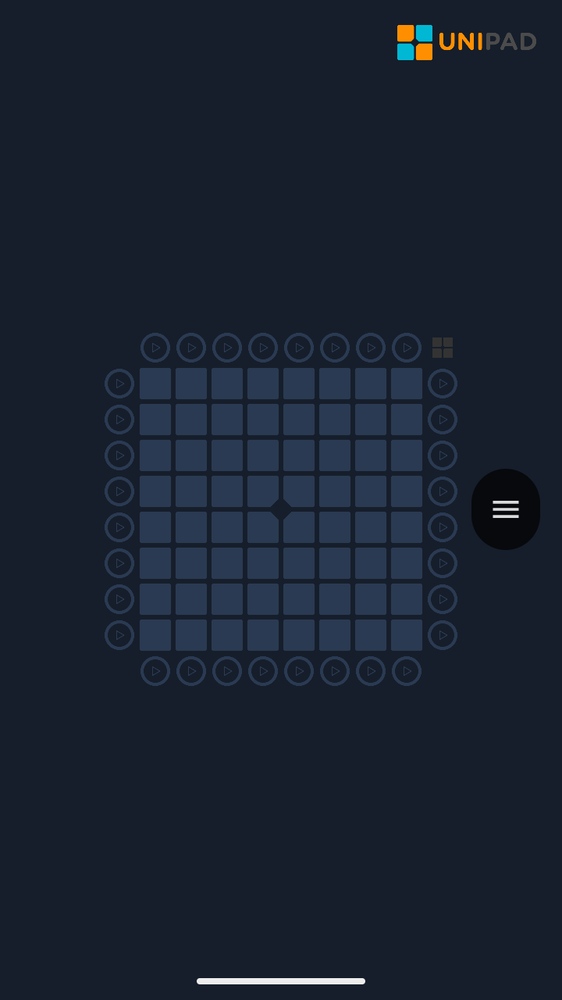
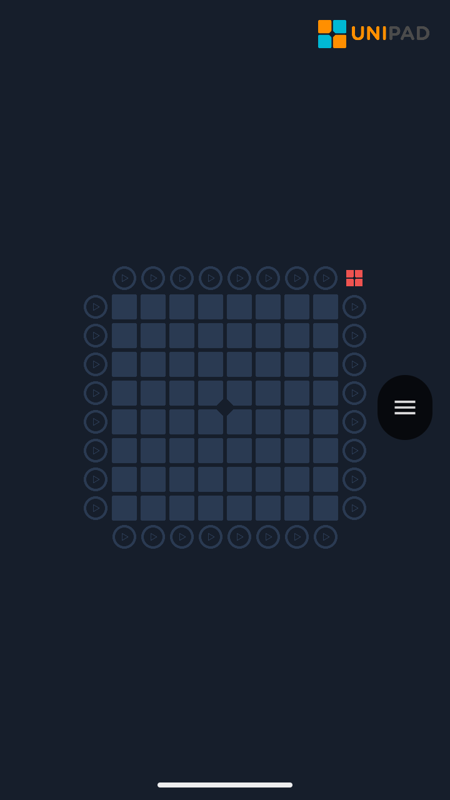
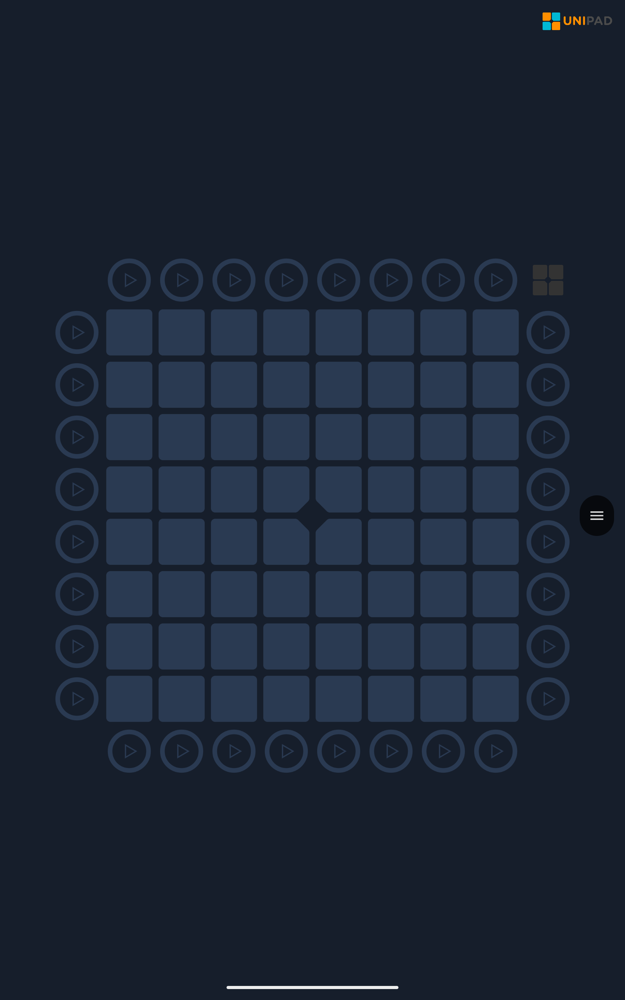
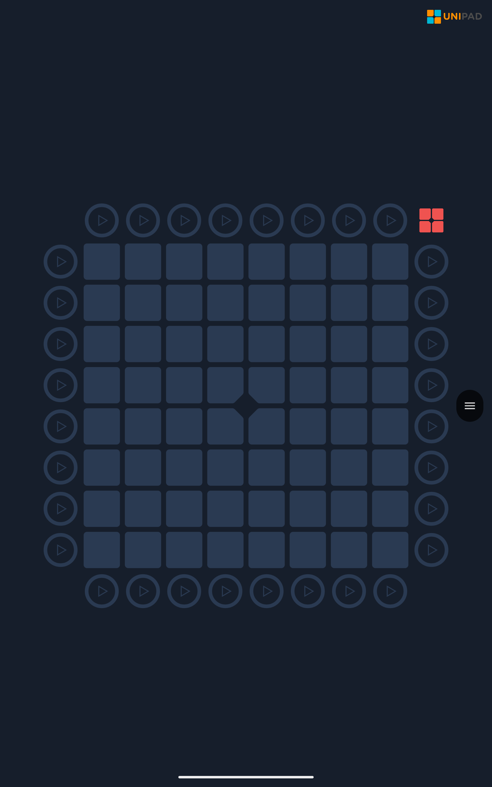
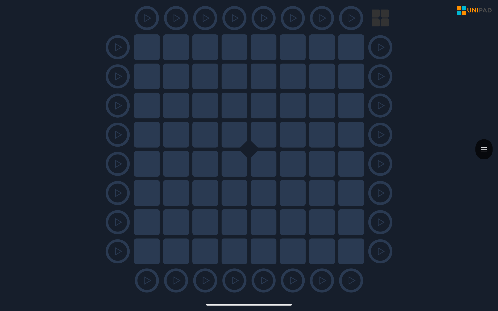
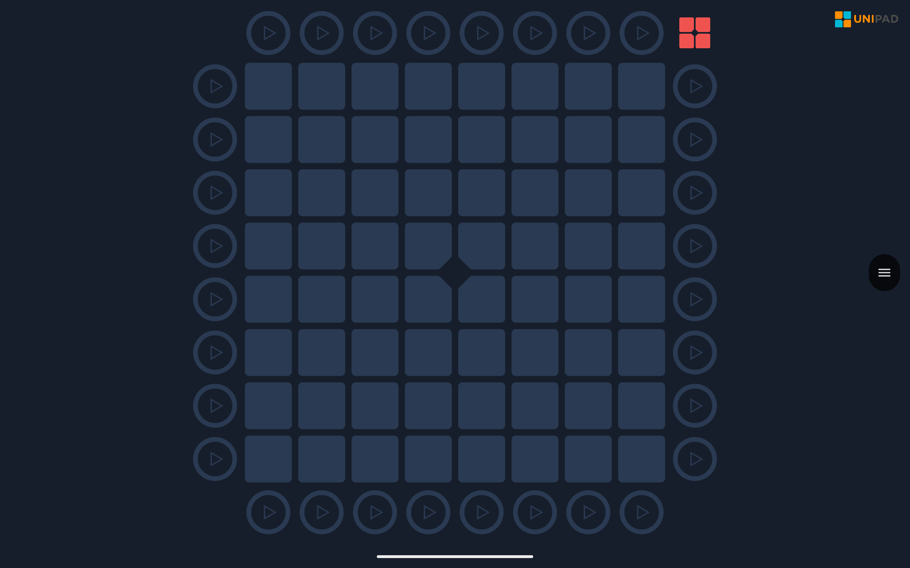
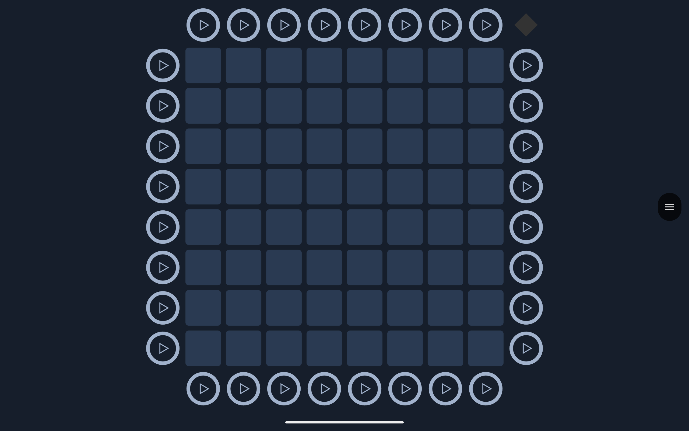
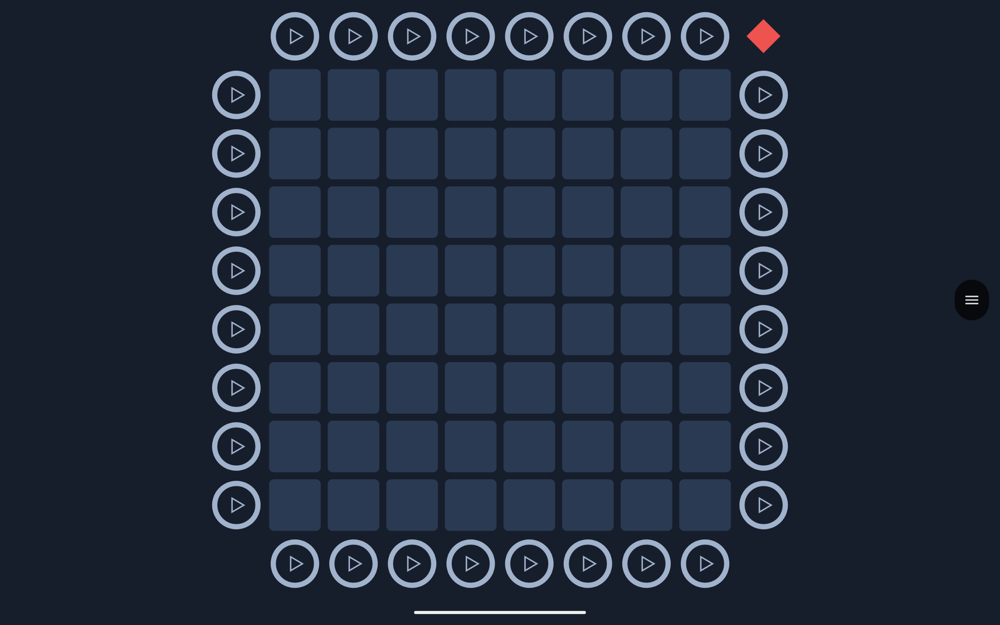
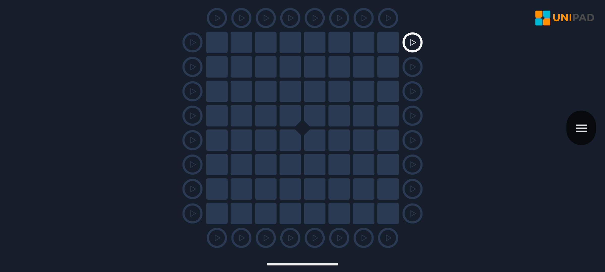

# Pro Light Mode logo examples

These are unmodified captures from the running app on an Android 15 emulator.
The logo and theme examples were captured with `LogoLedEvidenceTest` on
`26d5665b`. The before image is from `f59cb45c`; the after image uses the same
2400×1080 display. There are no overlays or simulated app drawings.

The same emulator was resized for each layout, at density 320 (two pixels per
dp). These are layout checks, not physical tablet or Launchpad tests. The
fixture disables the watermark to isolate pack LEDs and restores the setting
afterward. It uses `o l a 5`, `o l a 45` and `f l` in `basefeatures-pack`.

| Layout | Unlit | Red logo LED |
| --- | --- | --- |
| Phone portrait, 720×1280, 360dp wide |  |  |
| Tablet portrait, 1600×2560, 800dp wide |  |  |
| Tablet landscape, 2560×1600, 1280dp wide |  |  |
| Optional diamond mask, tablet landscape |  |  |

The example mask has transparent corners and green source pixels. Its red
appearance demonstrates that the app uses alpha and applies the pack color.
The test creates a reusable `diamond-theme.zip` and `commands-pack.zip` in its
capture output; it also covers other colors, missing and damaged masks, and
bundled-theme fallback.

| Before | After: default logo, unlit |
| --- | --- |
|  |  |
